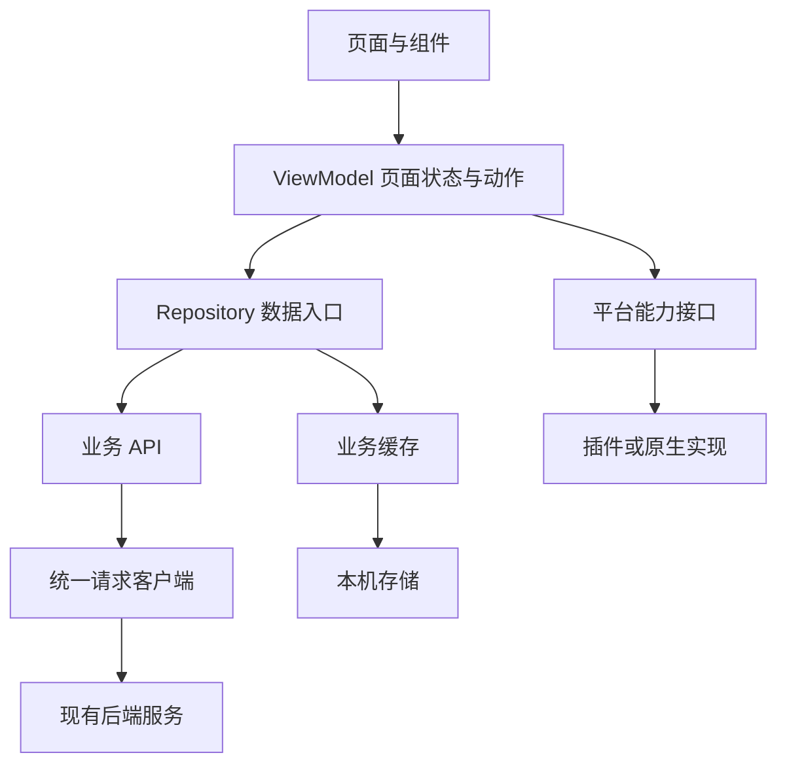

# 成信友友 Flutter 架构与编码规范

本文是成信友友移动端重写的实施基线，面向开发者和参与修改代码的 AI 助手。目标是让后来接手的人能够迅速找到代码、理解数据流，并在不影响其他功能的情况下完成修改。

**核心约定：按业务模块组织代码，页面负责展示，ViewModel 负责页面状态，Repository 负责数据获取与缓存。优先写直白的代码，用中文注释解释业务规则和设计原因。**

状态：工程已落地到根目录 `flutter/`，包含登录、课表、工具、校园及个人中心，已补齐校园跑、培养方案、反馈、本机头像和两端原生桌面课表小组件；另提供鸿蒙适配工程。更新日期：2026 年 10 月 13 日。构建方式和验证范围见 [Flutter README](../../flutter/README.md)。

适用范围：Flutter Android、iOS 客户端，以及原生鸿蒙适配的设计约束。`flutter/ohos/` 与本地鸿蒙插件已经加入，HAP 构建和真机验收仍需独立验证。现有 Vue Web/PWA 保留，继续遵守 [Web 开发规范](../../apps/web/DEVELOPMENT.md)。后端接口继续复用，服务端实现仍由独立私有仓库维护。

## 一眼看懂架构

| 要了解的问题 | 本项目的选择 |
| --- | --- |
| 代码按什么组织 | 按课表、成绩、考试、校园等业务模块组织 |
| 一个功能怎样运行 | 页面接收操作，ViewModel 执行动作，Repository 读取或更新数据 |
| 数据从哪里来 | 现有教务服务、校园服务，以及明确允许的本机缓存 |
| 什么代码跨端共用 | 页面、业务模型、业务计算、状态和大部分数据访问逻辑 |
| 平台差异放在哪里 | `core/platform/` 与 Android、iOS、鸿蒙各自的原生工程 |
| 如何控制复杂度 | 默认不加通用基类、全局事件总线、额外用例层或代码生成 |
| 什么最优先 | 正确、易读、易维护，然后才是少写几行代码 |

下面的箭头表示调用方向；数据和执行结果沿调用链返回，ViewModel 更新状态后，页面重新展示。



例如，点击“更新课表”后：`SchedulePage` 调用 `ScheduleViewModel.refresh()`，后者调用 `ScheduleRepository.load(semesterId, refresh: true)`；Repository 请求接口并更新缓存，ViewModel 接收结果，页面显示新课表。

应用启动、依赖创建、路由和退出登录的整体编排统一放在 `app/`。普通页面不用了解对象是如何创建的，也不用了解后端响应和缓存文件的细节。

阅读顺序：先看本节与[项目结构](#项目结构)，再看[各部分的职责和依赖](#各部分的职责和依赖)。开始开发前阅读[编码规范](#编码规范)和[新增功能的固定步骤](#新增功能的固定步骤)。

## 项目结构

仓库目标结构如下。只有开发到相应功能时才创建目录，不提前生成空壳。

```text
cuit-server/
├── apps/
│   └── web/                         # 现有 Vue Web/PWA 和 Capacitor 客户端
├── flutter/                         # 新建 Flutter 移动端工程
├── shared/academiccalendar/         # 已有的公开校历事实数据
├── docs/architecture/
│   └── FLUTTER_ARCHITECTURE.md       # 本文
└── .github/workflows/               # 按平台分别验证和构建
```

Flutter 当前实际结构如下。不为未实现的平台能力提前创建空目录。

```text
flutter/
├── lib/
│   ├── main.dart                    # 启动、等待和启动失败重试
│   ├── app/
│   │   ├── app.dart                 # 根组件、路由与登录访问控制
│   │   ├── app_dependencies.dart    # 依赖注入及账号范围的创建／释放
│   │   └── app_shell.dart           # 四个导航分支，保留页面状态
│   ├── core/
│   │   ├── config/                  # 公开 API 配置、主题和效果偏好
│   │   ├── network/                 # 请求、错误、平台 Cookie 适配
│   │   ├── platform/                # 桌面小组件契约与 MethodChannel
│   │   └── storage/                 # 安全存储、文件缓存和内存实现
│   ├── ui/
│   │   ├── theme/app_theme.dart     # 明暗主题及文字样式
│   │   └── components/              # 页面骨架、选择、菜单、弹窗、弹层与导航
│   └── features/
│       ├── session/
│       │   ├── session.dart         # 模块对外入口
│       │   ├── models/student.dart
│       │   ├── data/session_repository.dart
│       │   └── presentation/        # 登录、我的、会话状态
│       ├── tools/
│       │   └── presentation/        # 成绩、考试、图书馆、地图、资料等页面
│       ├── campus/                 # models / data / presentation；评分与二手
│       ├── autorun/                # models / data / presentation；独立校园跑
│       ├── profile/                # 本机头像、培养方案与反馈
│       └── schedule/
│           ├── schedule.dart
│           ├── models/              # 课程、学期、校历与教学周计算
│           ├── data/
│           │   ├── schedule_repository.dart
│           │   ├── default_schedule_repository.dart
│           │   └── demo_schedule_repository.dart
│           └── presentation/        # 页面、状态、网格与课程详情
├── assets/data/calendars.json        # 构建时同步的公开校历副本
├── assets/data/autorun/              # 原 Vue 的两校区轨迹地图
├── assets/avatars/                   # 原 Vue 的 15 张本机预设头像
├── test/                            # 数据、并发与组件测试
├── integration_test/                # 原生存储与演示流程测试
├── test_driver/                     # 导出集成测试截图
├── tool/                            # 运行包装、校历同步和检查脚本
├── android/                         # Android 权限、配置和原生入口
├── ios/                             # iOS 原生入口、共享数据与 WidgetKit 扩展
├── web/                             # 生成的预览壳；Web 端尚未验收
├── docs/LIQUID_GLASS.md               # 液态玻璃选型与验证约束
├── pubspec.yaml / pubspec.lock       # 依赖声明与已解析的版本
├── analysis_options.yaml            # 静态检查规则
└── README.md                        # SDK、运行、范围及验证方式
```

首版把很短的启动流程留在 `main.dart`，路由留在 `app.dart`，会话生命周期放在 `app_dependencies.dart`。Repository 内暂时直接组合简单接口与缓存，未来逻辑增多再拆 `schedule_api.dart`、`schedule_cache.dart`；不为示意架构创建空层。

成绩、考试、空教室和图书馆页面位于 `tools/presentation/`；评分、二手位于 `campus/`；校园跑位于 `autorun/`；培养方案、反馈与头像位于 `profile/`。`core/platform/` 已包含桌面小组件的平台契约；其他系统能力按需要添加接口。原生鸿蒙工程已位于 `flutter/ohos/`，使用 `.flutter-ohos-version` 固定的 Flutter OH 工具链；系统安全存储由 ArkTS 通道实现，其他平台插件固定在 `packages/ohos_plugins/`，构建与真机验证范围见鸿蒙 README。

工具二级页分别维护页面文件，`academic_tool_pages.dart` 只保留教务工具的路由导出。公共标题、分组容器和筛选样式集中在 `ui/components/page_layout.dart`；`tool_page_scaffold.dart` 保留工具入口命名及返回提示，学期筛选集中在 `academic_tool_widgets.dart`。业务页面直接组合组件并按需使用局部主题，不修改课表网格的独立样式。与 Vue 的 UI 对应关系见 [工具二级页对照](../../flutter/docs/TOOLS_UI_PARITY.md)和[其他页面对照](../../flutter/docs/OTHER_PAGES_UI_PARITY.md)。

公共选择框、菜单、对话框与底部弹层分别放在 `page_selection.dart`、`page_menu.dart`、`page_dialog.dart` 和 `page_sheet.dart`。它们只负责显示、主题、弹出层级和布局，页面通过当前值、选项、回调和返回值组合使用；业务权限、请求和校验留在所属模块，不建立组件工厂或额外状态层。接口说明和使用示例见 [公共 UI 组件](../../flutter/docs/UI_COMPONENTS.md)。

校历继续以 `shared/academiccalendar/` 为唯一事实来源。`python3 flutter/tool/sync_calendar.py` 同步资源，`--check` 验证一致性，不人工维护另一份日期。

桌面小组件的课程摘要与同步控制器属于 `schedule/`，复用正式课表规则，始终同步实际当天所属学期。`core/platform/desktop_widgets.dart` 只负责原生通道，Android 用 RemoteViews 读取私有摘要，iOS WidgetKit 扩展通过 App Groups 读取原子 JSON。账号生命周期和点击导航在 `app/` 组装；原生扩展不访问教务接口，不接收登录凭证。新增原生代码需要完整安装包，iOS 真机还需主应用与扩展的 App Groups 签名。具体边界与验证见 [桌面小组件](../../flutter/docs/DESKTOP_WIDGETS.md)。

## 各部分的职责和依赖

### 页面与组件

页面负责布局、展示状态、收集输入和触发动作。按钮点击、弹窗开关、焦点与动画属于界面职责；接口请求、缓存策略和教学周计算不放在页面中。

简单且只影响当前组件的临时状态可以使用 `setState`，例如密码是否可见。需要协调多次请求、账号切换或可复用业务规则时，由 ViewModel 管理。简单表单和单次读取页面可以用局部状态调用 Repository，但不在 `build()` 中发起请求；每次异步返回检查组件是否仍在界面中，重复查询使用请求编号拒绝旧结果。现有工具页仍有直接调用 ApiClient 的实现，新增或复杂化功能时逐步把数据访问移入 Repository。纯说明页面不需要为了凑齐结构创建 ViewModel 和 Repository。

### ViewModel

ViewModel 是页面的状态管理对象：接收“刷新课表”“切换学期”等动作，调用 Repository，并维护加载状态、当前数据和可展示的错误。

ViewModel 不持有 `BuildContext`，不直接弹窗或跳转，不使用具体 HTTP、数据库或原生插件。页面根据动作结果或状态执行界面操作。业务计算增长时，提取为模块内的纯函数。

### Repository

Repository 是模块的数据入口，决定读取缓存还是服务端，维护数据一致性，并向上提供明确的业务模型。ViewModel 不需要知道数据存储在哪里。

在需要替换数据来源和编写假实现的 Repository 边界定义小接口，例如 `ScheduleRepository`；生产实现使用 `DefaultScheduleRepository`。测试用假实现放在 `test/fakes/`。接口只暴露调用方真正需要的能力，不为每个普通类再复制一份接口。

### API 与缓存

`ScheduleApi` 只描述课表请求、参数、响应校验和转换；`ScheduleCache` 只处理本模块缓存。它们不直接更新页面、不导航，也不互相调用，由 Repository 组合。

通用 HTTP 处理和文件读写放在 `core/`，业务路径、缓存键和过期规则留在各自模块。这样更换 HTTP 库或存储实现时，页面不需要跟着修改。

### 应用组装与公共代码

依赖方向固定为：

```text
main → app → features → core
                  └──→ ui → core

模块内部：presentation → Repository 契约与 models
                         Repository 实现 → API / Cache → core
```

必须遵守以下边界：

1. `core/` 不导入 `features/`、`app/` 或业务界面；`ui/` 不依赖具体业务和路由。
2. feature 不导入 `app/`。需要的依赖通过构造函数传入；需要导航时交给页面或路由处理。
3. 一个 feature 不直接导入另一个 feature 的 `presentation/`、API 或缓存实现。确有业务依赖时，只通过对方公开入口中的模型或数据契约，并保持单向依赖。
4. 同时操作多个模块的流程放在 `app/`，例如退出登录后清理课表、个人信息和校园凭证。模块不能互相触发清理。
5. `app/dependencies.dart` 可以通过模块公开入口取得生产实现并组装对象；普通页面只接触自己的 ViewModel。
6. 同模块使用相对导入，跨模块使用明确的 `package:` 导入；公开入口只导出必要类型，禁止建立导出全项目的大文件。
7. `core/` 与 `ui/` 只接收职责明确的公共能力。一个业务组件被两个页面使用，也不代表它应该离开所属业务模块。

## 技术选择

以下是本项目的默认选择。引入其他方案前先说明当前方案解决不了的具体问题。

| 用途 | 默认选择 | 使用边界 |
| --- | --- | --- |
| 页面与布局 | Flutter Widgets | 复用组件表达清晰的界面结构 |
| 页面状态 | `ChangeNotifier` | 一个对象负责一组关联页面状态，不建立全应用大状态对象 |
| 依赖注入和订阅 | `provider` | 在应用或路由入口提供对象，业务类使用构造函数接收依赖 |
| 路由 | `go_router` | 集中管理路径、访问控制、返回与深链接 |
| HTTP | `dio` | 只在数据和基础设施边界使用，页面不接触其响应和异常 |
| 模型 | 普通 Dart 类，字段优先 `final` | JSON 手动转换，必要时再引入生成工具 |
| 静态检查 | `flutter_lints` 和 `dart format` | 自动处理格式和常规问题，评审关注业务与可读性 |
| 平台能力 | 已验证的插件加少量封装 | 封装只表达本项目需要的操作 |
| 代码热更新 | Shorebird / `shorebird_code_push` | 只更新 Dart 层；原生代码、引擎及打包 assets 仍发布新安装包 |

状态与数据职责参考 [Flutter 架构指南](https://docs.flutter.dev/app-architecture/guide)，选型取舍参考 [Flutter 架构建议](https://docs.flutter.dev/app-architecture/recommendations)。本项目选择直观的方法调用，不默认引入 Command 框架、额外 domain/use case 层、Service Locator 或多套状态管理方案。

首版验证使用 Flutter 3.47.5 / Dart 3.13.4，依赖通过 `flutter/pubspec.lock` 固定；后续升级先完成同一组检查，验证结果记录在移动端 README。Android、iOS 使用官方 Flutter 工具链，原生鸿蒙使用匹配的 Flutter OH 工具链；三端共用源码需要限制在共同支持的 Dart、Flutter 和插件能力内。不能把“纯 Dart 包”直接当成“所有版本和平台均兼容”的保证。

热更新位于 `features/app_update/`：`AppUpdateRepository` 定义检查、下载和读取本机补丁的契约，Shorebird 适配集中在生产 Repository，ViewModel 管理并发、重试及释放后的旧结果。应用入口创建应用级对象并在首屏后台检查，不依赖登录或业务 API；个人中心通过应用组装层传入更新组件。`shorebird.yaml` 设置 `auto_update: false`，由客户端统一调度。正式基础包用 `tool/shorebird.sh release` 固定 `.flutter-version`；补丁明确指定基础版本。账号绑定、平台签名与真实补丁验收范围见 [热更新说明](../../flutter/README.md#热更新)。

## 状态与异步流程

### 状态的归属

| 状态 | 放在哪里 |
| --- | --- |
| 输入焦点、密码可见、展开与收起 | 当前组件 |
| 当前教学周、页面加载、刷新与错误 | 当前功能的 ViewModel |
| 跨页面共用的课表数据与缓存策略 | 该功能的 Repository |
| 登录状态、当前账号与凭证有效性 | `session` 模块 |
| 主题偏好等应用设置 | 应用级设置对象，按需创建 |

每份状态只设一个权威来源。ViewModel 可以保存当前展示快照，但不能再建一套独立持久缓存；多个页面需要共享变化时，订阅同一个 Repository 或使用同一个有明确作用域的 ViewModel。

只保存无法直接推导的状态。课程数量从课程列表计算；空状态由“请求完成且列表为空”得出，不额外维护一个容易失真的 `isEmpty`。

页面必须区分首次加载、显示内容、刷新中、空数据和失败。刷新失败时保留已有内容并提示；首次请求失败时展示错误与重试入口，不把失败显示成“暂无数据”。复杂到多个布尔值可能组合出矛盾状态时，再使用一个明确的状态枚举或状态类。

### 对象生命周期

- 默认在路由范围创建页面 ViewModel，页面离开且不再保留时释放。底部主要页面是否保留状态，由 `app_shell.dart` 明确决定，不把所有页面永久缓存。
- 使用 `ChangeNotifierProvider(create: ...)` 创建的 ViewModel 由其自动释放；通过 `.value` 提供已有对象时，创建方负责释放。普通 `Provider` 管理的网络客户端等资源需显式配置 `dispose`。Repository 和网络客户端的存活范围与账号或应用范围保持一致。
- `build()` 只描述界面，不在里面发请求、读文件、排序大列表或创建长期订阅。
- 定时器、订阅、动画控制器和请求在相应对象销毁时清理；异步返回后不得更新已释放的对象。

### 并发和旧结果

对同一查询重复触发加载时，合并正在进行的相同请求。用户快速切换学期或搜索条件时，允许最新查询生效，通过取消请求或请求序号丢弃旧结果，不能只用一个 `isLoading` 阻止新查询。

账号切换和退出登录必须先使旧会话范围失效。发起请求时记录账号范围与会话代次，写入内存或缓存前再次检查；即使 HTTP 取消没有成功，旧请求也不能把上一账号的数据写回来。缓存清理与正在进行的写入也要协调顺序，避免清理完成后旧写入再次生成文件。

查询请求和提交操作采用不同规则。发布二手信息、提交评分等写操作应禁用重复提交；已有幂等键和版本字段继续沿用。网络超时不能直接认定提交失败，也不能自动重复写入，先查询结果或让用户明确重试。

## 接口与本机数据

### 保留现有服务边界

当前前端已经使用两类认证，Flutter 迁移保留对应契约：

| 服务 | 现有入口 | 认证及约束 |
| --- | --- | --- |
| 教务及主服务 | `/api/v1/jwxt/session`、课表等接口 | 使用本项目服务端签发的会话 Cookie |
| 校园评分与二手 | `/api/v1/ratings/*`、`/api/v1/marketplace/*` | 使用独立 Bearer Token，不携带教务会话 Cookie |
| 校园凭证签发 | `/api/v1/auth/ratings-token` | 通过主服务会话申请校园 Token |

上述内容来自现有 [会话接口](../../apps/web/src/features/session/api.ts)、[校园凭证逻辑](../../apps/web/src/features/ratings/auth.ts)和[校园请求客户端](../../apps/web/src/features/ratings/client.ts)。这是已有接口的迁移约束，不是新增后端设计。

两类服务使用独立配置的请求客户端，限制凭证发送的目标地址；认证请求不随意跟随到其他来源的重定向。认证逻辑归 `session`，底层客户端通过注入的凭证读取和失效回调协作，`core/` 不反向引用业务模块。

Flutter 原生 HTTP 需要显式处理 Cookie 的接收、发送和清理，不能假设浏览器或 Capacitor 的 Cookie 管理会自动迁移。持久登录所需的本应用凭证经安全存储保存，不写入普通偏好设置。首版使用 `flutter_secure_storage`（Android / iOS）与 ASSET 保护密钥的 AES-GCM 存储（鸿蒙），已验证 iOS 模拟器读写；Android 真机及鸿蒙仍需分别验证，不能继承其他平台的验证结论。学校密码仅用于当前登录请求，不持久化；客户端不直接访问学校 CAS/EAMS，不保存学校 Cookie 或 ticket。

### 请求和错误

请求客户端统一处理超时、响应外层结构和错误分类，API 层校验业务字段并转换模型。页面只接收业务对象和可展示的状态，不接收 `Map<String, dynamic>`、HTTP 响应对象或底层库异常。

区分断网、超时、服务异常、业务校验失败和认证失败。只有主服务明确判定会话失效时，才触发全局退出；校园服务 401 先尝试重新获取校园 Token，最多重放一次可安全重试的请求。若只是校园服务仍拒绝访问，显示该功能的认证错误；若主服务同时确认失效，再统一退出。并发的 Token 获取合并为同一个进行中的任务。

可预期的请求错误由 ViewModel 转为中文提示。未知异常保留不含敏感数据的诊断信息，并展示通用失败提示，不能空 `catch` 后返回空列表。取消的过期查询无需弹错误。自动重试只用于已确认安全的请求，提交操作遵守上一节的幂等规则。

### 缓存和账号隔离

缓存按照数据性质分别处理：

| 数据 | 策略 |
| --- | --- |
| 公开校历、应用图标 | 随包资源，与账号无关 |
| 公开公告、阅读次数 | 按公告服务地址／平台／缓存版本保存，列表最多 20 条、阅读记录最多 100 个版本；成功空列表清除旧内容，断网仅手动展示有效缓存，退出不清理公开阅读记录 |
| 主题等偏好 | 少量键值数据，退出登录可以保留 |
| 课表、教室占用、个人资料中需离线展示的字段 | 按账号隔离的业务缓存，明确字段范围、版本和清理规则 |
| 手动课程等用户创建的本机数据 | 独立于可重建缓存保存；迁移和清理规则需对用户可解释 |
| 校园图片缓存 | 区分公开与受保护内容，限制容量；受保护内容随会话清理 |
| 密码、学校票据 | 不持久化 |

每种业务缓存需要在所属模块明确：归属账号、缓存键、结构版本、更新时间、大小限制、损坏处理和清理时机。缓存键包含相关维度，例如 `账号 / 学期 / 校区 / 数据版本`。未经定义的数据不自动持久化，新增成绩等缓存必须同步补充此表及清理流程。

迁移时采用以下约束，其中课表和空教室继续保留现有加载行为：

1. 已有当前学期课表时，进入页面先读本机数据；只有无缓存、用户主动更新或切换到其他学期时请求远端。顶部菜单切周只做本地排课计算，不请求服务端。
2. 空教室按学期和校区获取占用快照，周次、星期、节次、教学楼和容量等筛选在本地完成。
3. 首版冷启动先校验已有会话，断网时允许经过验证的本机身份读取缓存并标明离线恢复。后续可优化为先显示缓存再后台校验；离线可读不代表远端已经认证，受保护的写操作仍需要有效会话。
4. 网络失败不清空有效缓存。可重建缓存损坏时仅丢弃对应条目；本机手动课程迁移失败时保留原数据并报告问题，不能按普通缓存直接删除。
5. 主动退出、明确会话失效和切换账号时，通过 `app/app_dependencies.dart` 与注入的清理回调 清理旧账号的内存、凭证与受保护持久数据。手动课程归属账号，清理前按产品规则提示；确认会话失效时不得继续暴露旧账号数据。
6. 文件写入采用临时文件替换等可恢复方式；清理失败必须使旧数据不可再被当前会话读取，并记录可诊断错误，不能静默宣称已清理成功。

启动时需要一个稳定且经过会话校验的账号标识来组织数据。首版使用 `/api/v1/jwxt/profile` 返回的 `StudentNo`，不能只凭用户输入的学号把缓存认定为已认证账号的数据。

## 多平台适配

Android、iOS 共用 Dart 页面与业务代码；原生鸿蒙使用 Flutter OH 适配工具链。Flutter 官方平台列表和 Flutter OH 的支持范围分别以各自维护方为准，不能因为 Android 能运行就认定鸿蒙也已经支持。

| 能力 | 共用部分 | 需要分别验证的部分 |
| --- | --- | --- |
| 课表、成绩、考试界面 | Dart 布局、规则和状态 | 字体、屏幕尺寸、滑动与切页性能 |
| 文件与日历导出 | 导出数据、文件内容和业务流程 | 文件位置、系统分享和目标应用行为 |
| 相册与文件选择 | 选择后的业务处理 | 权限、插件实现和返回数据 |
| 登录与本机保存 | 认证流程和缓存策略 | Cookie、安全存储与账号清理 |
| 返回、键盘和安全区 | 页面结构与路由意图 | Android 返回操作、iOS 返回手势、鸿蒙系统行为 |
| 构建与发布 | 业务源码和资源 | SDK、签名、包配置和分发流程 |

调用系统能力时优先选用已验证的插件，由 `core/platform/` 提供语义明确的方法。平台判断集中在此处；确有视觉差异的适配集中在 `ui/` 或应用导航中，不在各业务页面到处写平台分支。

不同平台需要独立实现时，再建立相应文件；插件已经统一的功能不重复写三套。平台不支持某能力时提供明确状态，界面隐藏入口或解释原因，不能调用空方法后假装成功。

插件接入前记录 Android、iOS、鸿蒙的可用版本、所需权限和真机验证结果。鸿蒙适配版插件的依赖来源及固定版本写入 `pubspec.yaml` 和锁文件，不能依赖会持续变化的分支来决定正式包内容。首期重点验证网络会话、安全存储、课表缓存、图片选择与文件分享。

现有 Capacitor OTA 热更新只更新原客户端的 Web 资源，不能直接用于新的 Flutter 代码。首期按各平台安装包更新；保留现有应用标识和签名时，也要单独验证覆盖安装、数据迁移与重新登录行为。

参考：[Flutter 平台支持](https://docs.flutter.dev/reference/supported-platforms)、[Flutter OH 工具链](https://gitcode.com/CPF-Flutter/flutter_flutter)、[鸿蒙插件适配清单](https://gitcode.com/CPF-Flutter/flutter_packages/blob/master/README.md)。依赖版本需在落地时重新核对，不把路线图日期当成已经发布的能力。

## 编码规范

### 先让人读懂

代码应当让熟悉 Dart 的开发者顺着文件从上到下理解业务，不需要先研究一套自定义框架。评审优先判断名称、分支和数据流是否明确，不以代码短、语法新或抽象多作为质量标准。

必须遵守：

1. 优先使用清楚的 `if`、`switch`、循环和 `async/await`。简单的 `map`、`where` 和表达式可以使用；需要反复推演的链式操作应拆为有业务名称的中间变量。
2. 一个函数完成一项明确工作；开始混合请求、转换、存储和展示时按职责拆开，不机械限制行数，也不把每两行代码拆成一个函数。
3. 条件复杂时先写有含义的布尔变量。避免多层嵌套三元表达式、隐藏副作用的 getter 和过长的回调嵌套。
4. 默认不写 `BasePage`、`BaseViewModel`、`BaseRepository` 等通用基类。重复布局用组件组合，重复流程先确认业务含义是否真的相同。
5. 不为单一调用点引入泛型框架、反射式注册或全局事件总线。已经有两个稳定的相同需求时，再讨论最小必要抽象。
6. 不滥用扩展方法、mixin、运算符重载、复杂模式匹配或代码生成。使用这些能力必须让调用方更容易理解，不能只是展示语言技巧。
7. 不用全局单例隐藏依赖。构造函数应能直接看出这个对象需要什么。
8. 修改保持聚焦。修复课表问题时不顺手重写其他模块，不保留注释掉的旧实现。

例如，“优先使用本机课表”的判断应直接表达业务规则。以下是 Repository 内部的局部示例：

```dart
final cachedTable = await cache.read(semesterId);

// 切页不重新请求教务系统，只有用户主动刷新或没有缓存时才访问远端。
if (cachedTable != null && !forceRefresh) {
  return cachedTable;
}

final latestTable = await api.fetchCourseTable(semesterId);
await cache.write(latestTable);
return latestTable;
```

示例只说明控制流写法。实际实现还需在返回和写缓存前检查会话是否有效，并按缓存策略处理写入失败；不能把省略的边界当成可以忽略。

### 命名与类型

| 对象 | 规则 | 示例 |
| --- | --- | --- |
| 文件与目录 | 小写下划线 | `schedule_view_model.dart` |
| 类、枚举、类型 | 大驼峰 | `ScheduleViewModel` |
| 变量、参数、方法 | 小驼峰，表达业务含义 | `selectedWeek`、`refreshSchedule()` |
| 布尔值 | 能按自然语言理解 | `isRefreshing`、`canSubmit` |
| 私有成员 | 下划线前缀 | `_repository` |

代码标识符使用清晰英文，注释和面向用户的文案使用中文。避免 `data1`、`temp`、`manager`、`handle()` 这类脱离上下文无法理解的名字；集合使用复数，时间和数量注明单位，例如 `expiresAt`、`timeout` 使用 `DateTime`、`Duration`，价格沿用整数分 `priceCents`。

数据模型优先不可变，集合对外提供只读视图或不可变副本。公开接口声明清楚的参数和返回类型；使用具名参数表达业务含义，不堆叠含义不明的位置布尔参数。

`dynamic` 限制在 JSON 和插件等外部边界，进入业务层前完成检查与转换。不用 `!`、未经验证的强制转换或宽泛的 `ignore` 掩盖问题。只有字段含义明确允许为空时才使用可空类型，不能把关键字段缺失默认为成功的空值。

后端结构简单时不重复建立完全相同的 DTO 和业务模型；当接口字段、缓存版本或展示规则出现明显差异时，再引入独立映射。错误响应不能伪装成成功模型。

### 中文注释

中文注释应解释“为什么这样做”“规则从哪里来”“什么情况下不成立”。不逐行翻译代码，也不写没有信息的“处理数据”“优化逻辑”。

必须写清楚的地方包括：模块对外的数据契约、非直观的业务规则、缓存和认证约束、并发处理原因，以及系统或插件的兼容性处理。普通布局和含义清晰的赋值不强制注释。

公开契约使用 `///` 文档注释。下面的名称用于说明接口约定，其中 `CourseTable` 是本模块的业务模型：

```dart
abstract interface class ScheduleRepository {
  /// 获取学期目录，离线时可回退已有目录。
  Future<List<Semester>> semesters();

  /// 读取指定学期的课表，默认优先使用本机缓存。
  /// [refresh] 为 true 时访问服务端，失败不删除旧缓存。
  Future<ScheduleSnapshot> load(String semesterId, {bool refresh = false});

  /// 删除当前账号缓存，并使仓库失效。
  Future<void> clear();

  /// 阻止旧请求返回或写回数据。
  void invalidate();
}
```

对容易误解的规则，明确原因：

```dart
// 学校按校历标注的第一周计算教学周，不能用开学报到日替代。
final firstWeekMonday = calendar.firstWeekMonday;

// 用户可能在请求期间切换账号，旧响应不能写入新账号的缓存。
if (requestSessionVersion != currentSessionVersion) {
  return;
}
```

兼容性注释说明受影响的平台、原因及移除条件；`TODO` 写明待解决的问题和触发时机，能关联任务时附任务链接。代码行为改变时同步更新注释，不保留已经失效的解释。

命名和格式的基础规则参考 [Effective Dart](https://dart.dev/effective-dart/style)，文档注释写法参考 [Dart 文档规范](https://dart.dev/effective-dart/documentation)。

## 界面与性能

重写的直接目标是改善滑动和切页体验。每次性能取舍先看真实页面与真机数据，不能仅凭更换框架判断已经解决。

1. 延续现有信息层级和语义颜色，使用统一 `ThemeData` 管理明暗主题、文字和间距。参考 [现有 UI 设计规范](../../apps/web/UI_DESIGN_GUIDELINES.md)的设计意图，CSS、DOM 和尺寸写法不直接照搬。
2. 列表按需构建，图片按显示尺寸解码并设置缓存上限；不在一次切页中加载全部原图或构建大量不可见项目。
3. 课表按学期加载数据，切周在本地完成。排序、分组和布局所需数据在输入变化时计算，不在每次 `build()` 中重复处理。
4. 使用小范围的状态订阅，必要时使用 `Selector`；一个课程选择变化不应触发整个应用重建。能使用 `const` 的组件使用 `const`，但不为此牺牲代码清晰度。
5. 大面积实时模糊、多层半透明叠加和连续复杂动画默认不使用。确有设计需要时先测量，并提供轻量表面样式。优先保证触摸反馈、滑动和任务完成。
6. 文件读写使用异步接口；经过测量确认阻塞界面的重计算，再考虑 isolate。普通筛选不额外引入并发复杂度。
7. 验证系统字体放大、屏幕阅读、键盘遮挡、安全区、返回操作和减少动态效果设置。图标按钮要有明确语义说明，不能只靠颜色表达状态。

性能验收使用真机 profile 模式定位、release 模式确认体验。固定设备、系统版本、数据量和操作脚本，对比旧客户端与 Flutter 客户端的冷启动、课表切周、列表滚动和页面切换；记录帧耗时分布及卡顿帧比例，不能只看平均 FPS。

显示刷新率为 60 Hz 时，每帧预算约为 16.7 ms；120 Hz 时约为 8.3 ms。检查 UI 与光栅线程是否持续超出对应预算。大段位图解码、频繁界面重建或模糊效果的成本，参考 [Flutter 性能建议](https://docs.flutter.dev/perf/best-practices)逐项验证。具体验收基线在首期真机验证后写入移动端 README。

## 新增功能的固定步骤

以新增成绩功能为例，按以下顺序实施：

1. 确认用户流程、接口字段、权限和是否允许离线保存，先写清成功、空数据及失败时的表现。
2. 在 `features/grades/` 添加需要的模型；计算规则写为可独立测试的纯函数。
3. 在 `data/` 实现 `GradesApi` 与 Repository。没有缓存需求就不建立 Cache，也不先复制课表的全部目录。
4. 添加 `GradesViewModel`，只实现页面确实需要的加载和操作；通过构造函数接收 Repository。
5. 添加 `GradesPage` 及必要的业务组件，覆盖加载、内容、空数据、失败与重试状态。
6. 在模块公开入口导出必要类型，在 `app/dependencies.dart` 和 `app/router.dart` 完成组装及注册。
7. 补充关键规则和状态流转测试；在目标平台验证入口、返回、登录失效和性能。

当业务继续增长时，按实际问题扩展：

| 出现的问题 | 对应的扩展方式 |
| --- | --- |
| 多个页面使用同一课程卡片 | 提取到 `schedule/presentation/widgets/` |
| 一个 ViewModel 包含互不相关的流程 | 按页面或业务职责拆分 |
| 多个 ViewModel 重复复杂业务计算 | 先提取模块内纯函数，必要时才增加有明确名称的业务服务 |
| 一个操作必须组合多个模块 | 在 `app/` 增加明确的流程编排 |
| 多个应用确实复用稳定能力 | 再提取独立 Dart package，当前不提前拆包 |
| 插件不支持某个系统能力 | 实现小范围平台适配，不修改整个业务层 |

## 验证与文档维护

测试关注能出错的业务行为，不为了目录完整或覆盖率给简单转发函数、静态说明页增加重复测试。

| 验证对象 | 必须覆盖的关键行为 |
| --- | --- |
| 教学周与课表规则 | 学期边界、周一周日、跨年、非教学周及手动课程 |
| Repository | 缓存命中、主动刷新、损坏恢复和账号隔离 |
| ViewModel | 首次失败、刷新失败保留内容、快速切换条件、离开页面后请求返回 |
| 会话流程 | 退出与切号清理、旧响应丢弃、主服务与校园服务认证区别 |
| 提交操作 | 防重复提交、幂等键、版本冲突和超时后的结果确认 |
| 关键页面 | 加载、空数据、错误提示、重试和返回操作 |
| 平台能力 | 文件分享、权限、安全存储和覆盖安装的真机验证 |

测试样本使用虚构账号与脱敏响应，自动化测试不连接真实学校系统。日志不输出密码、Cookie、Token、ticket 或完整敏感 URL；环境地址和功能开关可以进入构建配置，密钥与真实账号不可以。

初始化 Flutter 工程及对应测试目录后，常规修改执行：

```bash
cd flutter
dart format --output=none --set-exit-if-changed lib test integration_test
flutter analyze
flutter test
```

只有确实存在的目录才传给格式检查。需要修改格式时直接运行 `dart format`；不要使用忽略规则绕过未解决的问题。流程测试另用目标设备执行 `flutter test integration_test -d <设备标识>`，构建成功不能代替交互和真机验证。

CI 分为通用检查、Android 构建、iOS 构建和鸿蒙构建。前两端与鸿蒙分别使用已记录的 SDK；iOS 使用 macOS 和 Xcode。未签名编译只证明能够构建，正式发布仍需各平台签名与分发验证。

修改模块边界、认证、缓存策略或依赖方案时同步更新本文；修改运行命令、SDK 和插件版本时更新移动端 README。目录示例、实际源码和说明保持一致，让文档始终能够帮助下一位开发者找到实现。

## 迁移顺序

| 阶段 | 交付内容 | 完成条件 |
| --- | --- | --- |
| 核心验证 | Flutter 基础工程、登录、课表、课程详情 | Android 与原生鸿蒙真机跑通并完成性能对比，iOS 同阶段完成运行与交互验证 |
| 常用功能 | 成绩、考试、空教室、个人信息 | 对照现有行为验收，离线与账号切换规则通过测试 |
| 校园与工具 | 评分、二手、图书馆、地图、校历、试卷及校园跑相关功能 | 认证、图片、文件和写操作逐项验证，按模块交付 |
| 发布替换 | 各平台安装包、签名、更新入口和迁移说明 | 验证旧版覆盖升级、数据去向、重新登录及失败恢复 |

现有 Vue 客户端在新版本覆盖必要功能前继续可用。不能默认 Flutter 可以直接读取旧 Capacitor 的 WebView/IndexedDB 数据；第一阶段就确认手动课程、偏好和缓存的迁移边界。若需要导出导入或重新登录，先形成具体方案，再发布替换版本。

当前工程已包含原 Vue 的常用业务页面。课表与校园跑增加原版函数生成的跨语言对照测试；个人中心的培养方案与反馈通过 ProfileRepository 访问主服务，头像按账号只保存在本机。校园和校园跑分别持有独立凭证，退出或切换账号时拒绝旧请求结果。当前平台验证、已知差异和后续验收范围以 [Flutter README](../../flutter/README.md) 为准。
