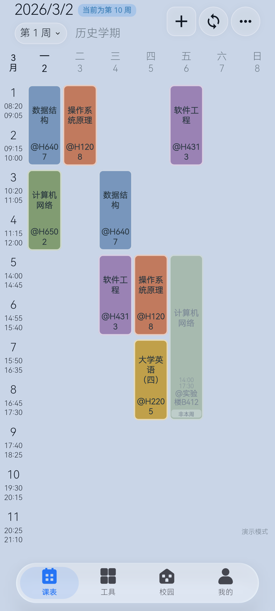
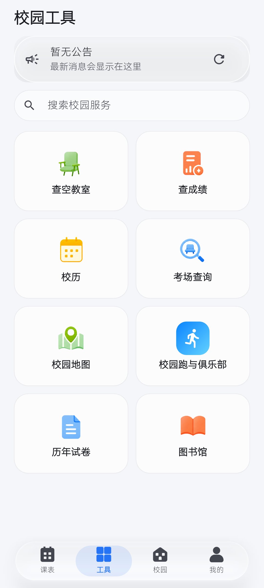

# 安卓字体

更新日期：2026-11-09。安卓单独使用 **HarmonyOS Sans SC**，iOS 继续用系统苹方 / SF Pro。本文记录原因、许可限制、字重映射和回退方式。

## 为什么只换安卓

iOS 的 `PingFang SC` + `SF Pro` 由系统提供，Flutter 通过 `CupertinoSystemText` / `CupertinoSystemDisplay` 直接拿到，观感统一。安卓上 Flutter 请求 `Roboto`，ROM 不一定有；小米实际回落到 `sans-serif`（MiSans），Pixel 则是 Roboto + Noto Sans CJK，同一份代码在不同机器上字面宽度和黑度都不一样。

苹方和 SF Pro 都不允许再分发，不能内嵌到安装包里。选区时按“接近苹方、允许商用”筛，最后选了 HarmonyOS Sans SC：它是华为免费商用的字体，字面比 MiSans 收，拉丁 x-height 也更接近苹方。

## 许可限制：不能 subset

`assets/fonts/HARMONYOS_SANS_LICENSE.txt` 是官方许可全文，关键两条：

- 允许 **embed、bundle、redistribute unmodified copies**，但 **不得修改字体或其中任何组件**；
- 必须在软件中显著声明使用了该字体，并保留版权声明与许可全文。

所以 `pyftsubset` 那套方案对这个字体**不合法**，只能原样打包。以后如果要压体积，只能换一款允许修改的字体（思源黑体 / Noto Sans SC，SIL OFL），而不是删这里的字形。

许可合规做了两件事：

1. 「我的 → 关于 → 开源许可」里登记了许可全文（[font_licenses.dart](../lib/ui/theme/font_licenses.dart)，`LicenseRegistry`）；
2. 「关于我们」页脚注明安卓字体与版权方。

## 文件与体积

| 文件 | 大小 |
| --- | --- |
| `HarmonyOS_Sans_SC_Light.ttf` | 8.2 MB |
| 合计（未压缩） | 8.2 MB |

只打包 Light 一个文件，release APK 为 **75.7 MB**（三字体版本是 86.0 MB）。Regular/Medium/Bold 仍留在仓库里备用，未在 `fonts:` 声明就不会打进包。字体属于 assets，**不能通过 Shorebird 补丁下发**，要发新的基础版本。

## 字重映射：只用 Light

实测发现 HarmonyOS Sans SC 的各个字重并不在同一个内部 family 里：

| 文件 | 内部 family | 内部 subfamily | OS/2 字重 |
| --- | --- | --- | --- |
| Light | `HarmonyOS Sans SC Light` | Regular | 300 |
| Regular | `HarmonyOS Sans SC` | Regular | 400 |
| Medium | `HarmonyOS Sans SC Medium` | Regular | 500 |
| Bold | `HarmonyOS Sans SC` | Bold | 700 |

Flutter 的资产字重匹配因此不可靠：把 Medium/Light 按 500/300 登记进同一个 `fonts:` family 时，它们不一定被当成该 family 的字重；而 `w600/w700` 更容易落到同 family 的 **Bold** 上——上一版“标签/标题偏粗”就是从这里来的（`w600` 的 99 处标签都拿到了 700 的字面）。

现在只登记 **Light** 一个文件：

```yaml
fonts:
  - family: HarmonyOS Sans SC
    fonts:
      - asset: assets/fonts/HarmonyOS_Sans_SC_Light.ttf
        weight: 400
```

所有字重都落到 Light，层级只靠字号。同一页实测文字墨量：

| 位置 | 旧（Bold/Medium） | 新（Light） |
| --- | --- | --- |
| 页面标题 | 0.455 | 0.357 |
| 工具名 | 0.478 | 0.366 |
| 说明文字 | 0.266 | 0.185 |

代价是标题不再比正文“重”，只剩大小差异；如果觉得太细，把 `fonts:` 换成 Regular 即可（改一行、重新打包）。

## 代码位置

| 位置 | 作用 |
| --- | --- |
| `pubspec.yaml` | 声明字体家族与四个字重 |
| `lib/ui/theme/app_theme.dart` | `_platformFontFamily`：仅 `defaultTargetPlatform == android` 时返回 `HarmonyOS Sans SC`；iOS 传 null |
| `lib/ui/theme/font_licenses.dart` | 把许可文本挂到 Flutter 的开源许可页 |
| `lib/features/profile/presentation/about_page.dart` | 关于页脚注 |
| `assets/fonts/` | 三个未修改的 TTF + 许可全文 |

鸿蒙（`defaultTargetPlatform.name == 'ohos'`）不会命中 `TargetPlatform.android`，继续用系统字体。

## 验证与回退

模拟器（Android 15 AOSP）实测：登录页、课表、工具页均正常显示 HarmonyOS Sans SC，`w700` 标题仍明显重于 `w600` 工具名，没有溢出。

| 课表 | 工具 |
| --- | --- |
|  |  |

「我的 → 关于 → 开源许可」里能看到 HarmonyOS Sans SC 的许可条目；关于页脚注也显示了字体与版权方。

注意：`flutter test` 里的组件测试不加载内置字体（测试环境用 Ahem），所以 **320 宽 / 3 倍字体的布局回归要在真机或模拟器上看**，不能只看测试通过。

回退到系统字体：

1. 删除 `pubspec.yaml` 里的 `fonts:` 段和 `assets/fonts/...` 资产项；
2. 删除 `AppTheme._platformFontFamily` 并在 `ThemeData` 去掉 `fontFamily`；
3. 删除 `main.dart` 的 `registerBundledFontLicenses()`、`font_licenses.dart`、关于页脚注；
4. 删除 `assets/fonts/`。

## 顺带修复的 Android 构建

接入 Firebase / flutter_local_notifications 后 release 构建失败，做了两处必要修改（与字体无关）：

1. `compileSdk = 37`：`androidx.core:core:1.19.0` 要求 API 37，本机已安装 `android-37.0`；
2. 打开 core library desugaring，并加 `coreLibraryDesugaring("com.android.tools:desugar_jdk_libs:2.1.4")`，`flutter_local_notifications` 需要。
