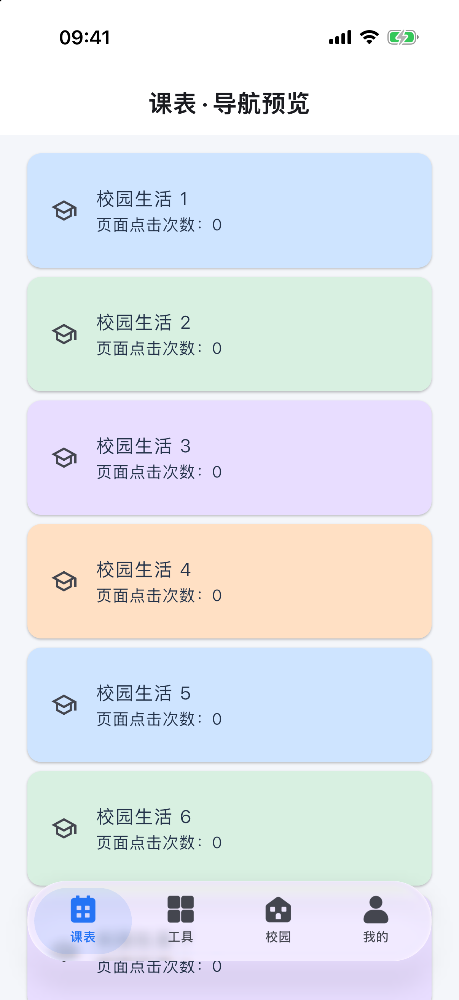
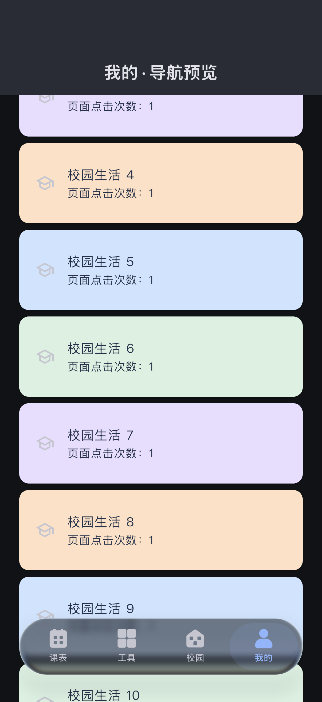
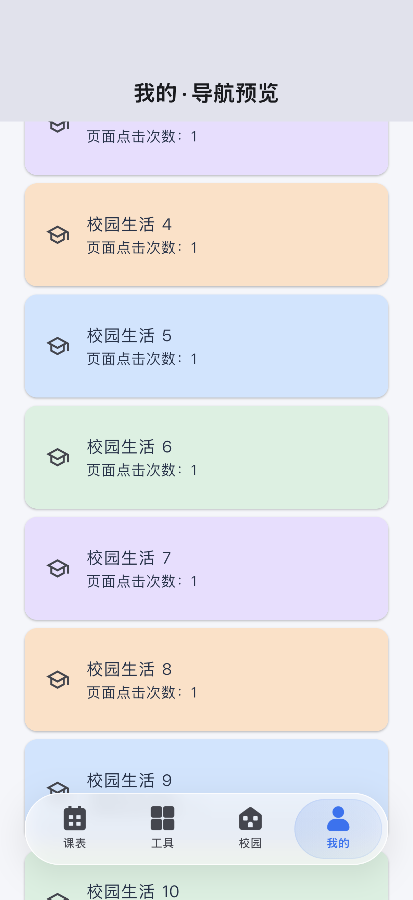

# 液态玻璃导航方案

更新日期：2026-10-07。目标是沿用原图标与悬浮胶囊宽度，增加安卓实时折射和自然的选中切换；不能以视觉效果牺牲课表滑动体验。

## 开源方案比较

| 方案 | 公开许可 | 本项目取舍 |
| --- | --- | --- |
| [liquid_glass_easy](https://pub.dev/packages/liquid_glass_easy) | MIT | 当前选用，固定 `4.3.4`；提供独立导航栏、原 PNG 图标接口与实时折射 |
| [liquid_glass_renderer](https://pub.dev/packages/liquid_glass_renderer) | MIT | 首版使用；已移除，避免同时保留两套材质和着色器依赖 |
| [liquid_glass_bottom_nav](https://pub.dev/packages/liquid_glass_bottom_nav) | MIT | 备选，基于 renderer 的导航封装，不会自动解决渲染后端降级 |
| [liquid_navbar](https://pub.dev/packages/liquid_navbar) | MIT | 基于 renderer，并额外依赖 Riverpod；不适合只替换当前导航组件 |

依据为各项目公开包页面和 `liquid_glass_easy 4.3.4` 源码。新库的 `.withImpeller` 导航可以读取实时背景，不需要把 GoRouter 页面交给库管理。它也提供 Skia 背景捕获方案，但本项目不使用；设备不能实时折射时直接使用小区域磨砂。

[Flutter 官方文档](https://docs.flutter.dev/perf/impeller)说明 Android API 29+ 默认启用 Impeller，较旧系统或不支持 Vulkan 的设备会降级。Manifest 中没有手动关闭 Impeller。是否能折射仍以运行时的 `ImageFilter.isShaderFilterSupported` 为准，不能从 Android 平台标识或包的支持列表推断。

## 当前实现

- iOS 由 `NativeTabBar` 使用 UIKit 原生导航；安卓与其他 Flutter 平台由 `GlassNavigationBar` 控制。
- `GlassNavigationBar` 与 `GlassSurface` 隔离第三方 API，业务页面不引用玻璃库；工具页公告表面也复用同一材质。
- 导航最大宽 390，正常高度 60、大字体至少 72；更大字体继续增加高度。根据安卓真机截图反馈，将本体高度从 70 缩减到 60，减少图标与文字上下留白。另留 12 像素空间给选中胶囊抬起，底部安全区和屏幕边缘间距继续沿用。
- 原 Vue 的四个 PNG 图标和透明留白校准比例继续使用；在液态导航首次显示前预加载图标和着色器，准备过程中仍可以通过磨砂导航切页。
- 支持实时着色器且未开启轻量／高对比度时，使用 `LiquidGlassTabBar.withImpeller`。导航外轮廓固定，选中胶囊使用接近临界阻尼的弹簧；短长按后可以拖动选中项。
- 关闭库默认的额外放大镜折射层，不设置自动背景采样、不使用整页截图捕获。玻璃只覆盖导航和既有公告表面，不加入滚动卡片。
- 轻量模式与不支持实时折射的后端使用 `BackdropFilter` 磨砂；浅色填充不透明度从 90% 降为 60%，深色从 90% 降为约 72%，让背景更容易透出。
- 高对比度使用实色并关闭模糊／折射；减少动态效果时保留静态材质，选中项立即切换。
- 库会绘制多层图标，导航另提供单一语义层，读屏可以识别入口、选中状态并执行切换。这个层不会拦截触摸，点击和拖动由库处理。
- 轻量开关仍保存在偏好设置中，不随账号清除；课表的切周和导航路由逻辑不变。

当前仍以 Android / iOS 为交付平台，Vue Web/PWA 继续保留。旧 renderer 的着色器编译限制已经随依赖移除；本次没有验收 Flutter Web 或鸿蒙，不能把运行时降级等同于这些平台已完整可用。

## 本次验证与预览

- Android debug APK 构建成功。
- 全部 215 项单元与组件测试通过；导航新增测试覆盖四个入口、页面触摸／滚动、读屏选中状态、高对比度、减少动态效果及 320 宽屏幕四倍字体。
- 新导航集成测试在已有 iPhone 17 Pro / iOS 26.5 模拟器上执行，确认进入实时 Shader Filter 分支、点击与长按拖动切页、主题切换及轻量降级。它验证 Flutter 组件的 Impeller 渲染与交互，**不代表安卓设备实测**。
- 当前未连接安卓真机，未测量安卓 UI／Raster 帧时间或温升，也未更新实体手机。

下面是 2026-10-06 在测试背景中生成的 Flutter 导航预览，使用调整前的 70 像素高度，并非安卓设备或 UIKit 导航截图：

| 浅色折射 | 深色折射 | 轻量磨砂 |
| --- | --- | --- |
|  |  |  |

首屏另外对照系统截图，确认四个 PNG 在没有切页前均正常显示；集成测试也检查进入液态分支时图片已解码。iOS 集成测试的首张 Flutter 截图曾遗漏图片，故此处首屏预览采用系统截图，而后续主题／降级预览采用测试截图。

复验方式：

```bash
./tool/flutter.sh test test/glass_navigation_test.dart
./tool/flutter.sh drive --driver=test_driver/integration_test.dart \
  --target=integration_test/glass_navigation_test.dart -d <支持实时着色器的设备标识>
```

## 验收要求

2026-10-07 收到用户提供的安卓真机截图后，收紧导航本体高度和上下留白。导航切页、读屏、小屏四倍字体、应用路由及页面布局共 13 项测试通过，静态检查无问题；重新生成的 Release APK 通过签名校验，副本为 `build/app/outputs/flutter-apk/chengxin-youyou-compact-nav.apk`。本次没有生成新的设备截图或测量安卓帧耗时，仍需在用户手机上查看调整后的比例。

模拟器已用于检查外观与交互，不能代替 GPU 性能验收。上线前在目标安卓中低端机及 iPhone 上，以同一份课表分别测试折射和轻量效果：

1. profile 模式滚动课表 30 秒、切周 30 次、切导航 30 次。
2. 记录 UI／Raster 帧耗时分布、超预算帧、内存与温升；60Hz 预算约 16.7ms，120Hz 约 8.3ms。
3. release 模式复查触摸响应、滚动连续性、深色和系统字体放大。
4. 若折射持续造成超预算帧，默认开启轻量模式后重新验证。

未取得真机记录前，不宣称“已经解决安卓卡顿”。鸿蒙工具链尚未验证，本版没有承诺其 Shader Filter 或插件可用性。
